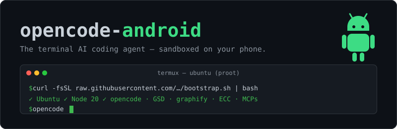

<p align="center">
  
</p>

<p align="center">
  Run <b>OpenCode</b> (terminal AI coding agent) on your Android phone in one command —<br>
  Termux + proot-distro Ubuntu, with your main files locked away in a sandbox.
</p>

<p align="center">
  
  
  
  
</p>

---

Works with an OpenCode Go subscription (auto-detected) or free Big Pickle, no
key needed. Ships: opencode, GSD, graphify, ECC, MCPs (context7, parallel,
tavily, exa), dcp context pruning, anti-hang shell rules, secure-by-default
config.

## Install

1. Install [Termux from F-Droid](https://f-droid.org/en/packages/com.termux/)
   (not Play Store).
2. In Termux:

   ```bash
   curl -fsSL https://raw.githubusercontent.com/YOUR-USER/opencode-android/main/bootstrap.sh | bash
   ```

   ~1–2 GB storage, ~15 min on Wi-Fi. Installs proot-distro + Ubuntu, the
   sandbox (no Termux-home access), Node 20, opencode and the full stack.

3. Use it (per project):

   ```bash
   proot-distro login ubuntu                      # enter the sandbox
   mkdir -p ~/my-project && cd ~/my-project
   git init                                       # setup must run in a git repo
   bash /root/opencode-android/setup-opencode.sh
   opencode
   ```

4. Model (one-time inside opencode):
   - OpenCode Go: `/connect` → OpenCode Go → paste key from
     [opencode.ai/console](https://opencode.ai/console), then re-run the setup
     script once to pick up `opencode-go/kimi-k3` (+ fast `small_model`).
   - No subscription: Big Pickle is already set, free, no key.

Manual fallback if the one-liner fails:

```bash
# Termux
pkg update -y && pkg install proot-distro
proot-distro install ubuntu && proot-distro login ubuntu
# Ubuntu (inside)
apt update && apt install -y curl git python3-pip pipx
curl -fsSL https://deb.nodesource.com/setup_20.x | bash - && apt install -y nodejs
git clone https://github.com/YOUR-USER/opencode-android /root/opencode-android
bash /root/opencode-android/setup-opencode.sh   # from your project dir
```

## Verify

After `opencode` launches: `/models` (Go or big-pickle), `/gsd-help`,
`/graphify .`, MCP servers listed at startup (context7, parallel-search,
tavily, exa), `@code-reviewer` for ECC subagents.

| Test | What it does |
| --- | --- |
| `bash tests/run-tests.sh` | Functional battery for the embedded config editor (exit 0 = pass) |
| `bash tests/verify-sandbox.sh termux` | In **Termux only**: plants canaries, checks the container can't reach Termux home / `/sdcard` |
| `bash tests/verify-sandbox.sh project` | In the container, project dir: config hygiene, secrets, plugin pinning |
| `bash tests/verify-sandbox.sh bench` | Wall time + peak memory of one opencode run |
| `tests/MANUAL-TESTS.md` | Behavioral tests the scripts can't cover (agent prompt-injection, canary, permission prompts) |

Re-running `setup-opencode.sh` is always safe and repairs `opencode.json`;
`DOCTOR_ONLY=1 bash setup-opencode.sh` only repairs/validates (backups go to
`opencode.json.bak.*`). Config broke after manual edits? Run the doctor.

## Tuning

| Variable | Meaning |
| --- | --- |
| `UNLOCK=1` | Allow-everything profile, no approval prompts |
| `SECURITY_PROFILE=secure\|keep` | `keep` leaves your permission settings untouched |
| `OPENCODE_MODEL` / `OPENCODE_SMALL_MODEL` | Force models, e.g. `opencode-go/grok-4.7` |
| `GO_MODEL` / `GO_SMALL_MODEL` | Models when a Go subscription is detected (default `kimi-k3` / `glm-5.3-flash`) |
| `ECC_SKILLS=all\|none` | ECC skills: all 300+, or none (default: 11 core) |
| `ENABLE_CONTEXT7=0` etc. | Disable context7 / parallel / tavily / exa / dcp / shell-strategy |
| `SKIP_GSD=1`, `SKIP_GRAPHIFY=1`, `SKIP_ECC=1`, `SKIP_MCP=1`, `SKIP_EXTRAS=1`, `SKIP_OPENCODE=1` | Skip a component |
| `TAVILY_API_KEY`, `EXA_API_KEY` | Put in git-ignored `.env`; wired as MCP headers, never inlined into JSON |

## Caveats

- **DNS inside proot**: clones/installs failing silently →
  `echo 'nameserver 8.8.8.8' > /etc/resolv.conf`
- **`Node reports platform=android`**: you're on Termux Node; run everything
  inside the proot distro (the setup refuses Termux Node by design).
- **Session killed with `signal 9`**: Android 12+ phantom process killer →
  `termux-wake-lock`, keep Termux in the foreground. Details:
  `docs/ANDROID-TIPS.md`.
- **RAM is the limit** on small phones: no browser E2E / Docker stacks in proot
  (run those in cloud/CI, see `docs/VIBE-PROJECTS.md`).
- **Security**: the proot container is the real boundary (no `--termux-home`
  binds); the config adds `share: disabled`, no auto-update, denies
  world-breaking commands, and asks before touching paths outside the project.
  Keys stay in `.env`/auth.json — never in `opencode.json`. Threat model:
  `docs/SECURITY.md`.
- `graphify` must be installed with `graphify install --platform opencode`,
  never bare (it targets Claude by default).

## Repo layout

```
bootstrap.sh                 Termux side: proot-distro + Ubuntu + first-run setup
setup-opencode.sh            Container side: installs + configures everything, idempotent
templates/security-profile.json   Auditable copy of the default permission set
tests/run-tests.sh           Automated test battery (29 checks)
tests/verify-sandbox.sh      Acceptance tests: sandbox leak, config hygiene, bench
tests/MANUAL-TESTS.md        Behavioral tests, done by hand in a throwaway project
docs/SECURITY.md             Threat model, layers, limits
docs/ANDROID-TIPS.md         Phantom killer, RAM, background jobs, wakelock
docs/VIBE-PROJECTS.md        Where pre-commit/gitleaks/Playwright/Docker actually belong
```
